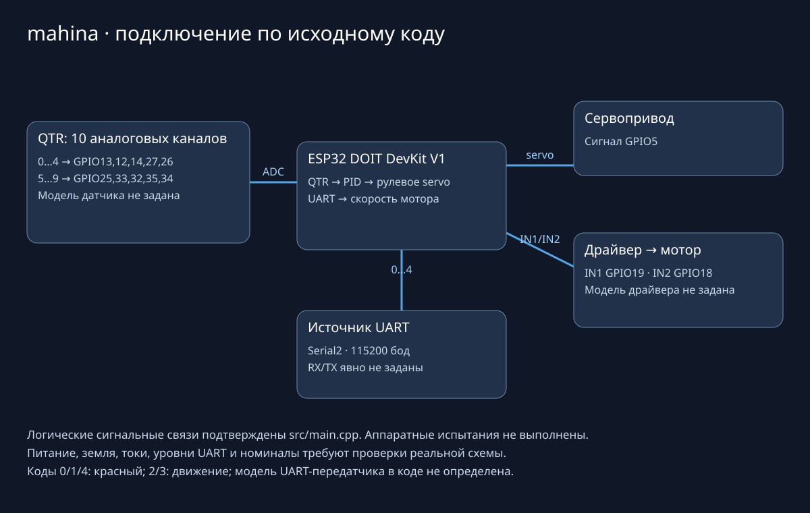

# mahina

**ESP32-машинка, следующая по линии и принимающая состояние светофора по UART.**

QTR-линейка определяет положение линии, PID задаёт угол рулевого сервопривода,
а отдельная FreeRTOS-задача управляет скоростью двигателя по сигналам остановки.
Проект — аппаратный прототип: поведение на собранной машинке не подтверждено.



## Устройство и подключения

Схема отражает только связи из `src/main.cpp`. Это не готовый монтажный чертёж:
модели драйвера/мотора, питание, токи, общая земля и номиналы в коде не заданы.

| Компонент | Подключение, заданное исходниками |
|---|---|
| Контроллер | ESP32 DOIT DevKit V1 |
| QTR, каналы 0–4 | GPIO 13, 12, 14, 27, 26 |
| QTR, каналы 5–9 | GPIO 25, 33, 32, 35, 34 |
| Рулевой сервопривод | Сигнальный GPIO 5 |
| Драйвер двигателя | IN1 GPIO 19, IN2 GPIO 18 |
| Приём кода светофора | Serial2, 115200 бод; RX/TX явно не заданы |
| Диагностика | Serial, 115200 бод |

Не подключайте мотор или сервопривод непосредственно к GPIO. Уровни питания и
UART необходимо сверить с реальными модулями до включения. Значения RX/TX следует
зафиксировать после проверки конкретной платы; схема не подставляет их автоматически.

## Алгоритм

| Задача | Работа |
|---|---|
| Task1, ядро 0 | Чтение QTR, первая область линии, взвешенный центр, PID и servo |
| Task2, ядро 1 | Приём UART, стоп-линия, ограничение/набор скорости и выходы двигателя |

QTR калибруется 200 чтениями при старте. Порог линии — 500, признаки стоп-линии
используют порог 800. PID сохраняет коэффициенты `0.01 / 0.0015 / 0.01`, время
измеряется в миллисекундах, угол ограничен диапазоном 57–123°. Базовый ШИМ — 60.

Исправленная обработка исключает деление на ноль при отсутствии линии и нулевом
временном шаге; переполнение `millis()` учитывается unsigned-разностью. При потере
линии сохраняется последняя позиция: автоматический поиск линии не реализован.
Данные между ядрами передаются через короткие critical sections, без аппаратного
ввода-вывода внутри блокировки.

## UART-контракт

Передаётся **один бинарный байт**, а не ASCII-цифра или текстовая строка.

| Код | Действие |
|---|---|
| `0x00`, `0x01`, `0x04` | Красный сигнал: остановка на стоп-линии, иначе треть базовой скорости |
| `0x02`, `0x03` | Разрешение движения, постепенное увеличение скорости |
| `0x05`, `0x06` | Не устанавливают новый цвет |

Таймаута потери UART-связи пока нет. После последнего разрешающего кода машинка
не получает автоматической остановки при обрыве канала.

## Сборка

Нужен PlatformIO Core. Плата и библиотеки уже описаны в `platformio.ini`:
Arduino, QTRSensors и ESP32Servo.

```sh
git clone https://github.com/MrRodikolion/mahina.git
cd mahina
pio run
```

Эта команда только собирает прошивку. Подключение и загрузка на устройство требуют
отдельной проверки схемы, калибровки датчиков и безопасного стенда.

## Файлы и проверка

- `src/main.cpp` — обе задачи, чтение линии, PID и UART.
- `platformio.ini` — плата, Arduino framework и зависимости.
- `src/mn.txt`, `src/p.txt` — существующие вспомогательные материалы; в сборку C++ не входят.
- `test/README` — шаблон PlatformIO, не автоматический набор тестов.

Фактические функции из исходников скомпилированы host C++-компилятором и прошли
11 проверок: нулевой шаг, переполнение времени, пустая/полная линия, крайний канал
и границы массива. Аппаратные функции в этой проверке заменены заглушками.
Полная PlatformIO-сборка ESP32 **не подтверждена**: загрузка отсутствующего
toolchain не завершилась за выделенное время. Испытания на машинке не выполнялись.

## Дальнейшая работа

- [ ] Проверить силовую схему, калибровку и ориентацию сервопривода на стенде.
- [ ] Зафиксировать UART RX/TX и добавить таймаут потери разрешающего сигнала.
- [ ] Определить безопасную политику потери линии вместо удержания последней позиции.
- [ ] Настроить PID на реальной механике; текущие коэффициенты не перенастраивались.
- [ ] Добавить постоянные регрессионные тесты в проект.
